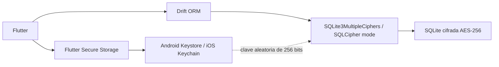

# Offline-first MVP: agricultor

## Alcance implementado

- Drift/SQLite como fuente local para el listado de productos.
- Cache separada por `ownerUsername`.
- Creacion, edicion y eliminacion local de productos.
- Conservacion de imagenes pendientes en el directorio de soporte de la app.
- Cola durable `sync_operations` con estados `pending`, `syncing`, `synced`,
  `failed` y `conflict`.
- Compactacion de una edicion sobre una creacion o edicion aun pendiente.
- Sincronizacion al recuperar conectividad y sincronizacion manual.
- Reintentos con espera exponencial entre 2 y 256 segundos.
- Indicador por producto, contador pendiente y fecha de ultima sincronizacion.
- Cache y CRUD offline de puntos de recojo.
- Indicadores de sincronizacion en la pantalla dedicada y en `Mis entregas`.
- Conflicto preservado cuando una fecha/horario deja de ser valido antes de
  sincronizar.
- Cache local de grupos de pedidos del agricultor.
- Consulta de clientes, productos, cantidades, entrega y pago sin conexion.
- Accion `MARK_ORDER_PREPARED` con cambio optimista y cola durable.
- Bloqueo de asignacion/despacho hasta que la preparacion sea confirmada.
- Estado explicito mientras el servidor confirma la preparacion y reintento
  manual desde la misma tarjeta del pedido.
- Reemplazo autoritativo del snapshot porque `groupKey` cambia con el estado.
- Cache local de entregas asignadas al repartidor.
- Consulta offline de agricultor, clientes, productos, cantidades, direccion,
  metodo de pago y numero Yape.
- Separacion estricta de la cache por `ownerUsername`.
- Limpieza de entregas cacheadas al cerrar sesion voluntariamente.
- Acceso a la cache del agricultor y repartidor si falla el refresh del token.
- Captura durable de ubicacion del repartidor aunque el backend no responda.
- Compactacion del tracking por subpedido: se conserva solo la posicion mas
  reciente para evitar enviar un historial obsoleto al recuperar conexion.
- Sincronizacion automatica del tracking, con reintentos y conflictos visibles.
- Hora de captura y de ultima sincronizacion en el detalle de entrega.

`connectivity_plus` solo dispara un intento. El resultado HTTP determina si el
backend esta realmente disponible.

## Idempotencia

Cada creacion genera un UUID local estable y lo envia como `clientId`. El
backend usa ese UUID como ID del producto y devuelve el producto existente
cuando el mismo agricultor repite el request. Clientes antiguos pueden omitir
`clientId`; en ese caso el backend genera el UUID como antes.

El mismo contrato `clientId` se aplica a la creacion de puntos de recojo.

La cola conserva tambien un `idempotencyKey` para extender el mismo patron a
puntos de recojo, tracking y confirmaciones de entrega.

## Datos y sesion

Un 401 que no puede resolverse mediante refresh no elimina la cache ni la
sesion local de agricultores o repartidores. La sesion queda marcada con
`requiresReauthentication`; las operaciones permanecen en la cola.

La base aun no esta cifrada. La cache del repartidor esta separada por usuario
y se elimina al cerrar sesion voluntariamente, pero antes de produccion se debe
agregar cifrado para direcciones, telefonos, metodos de pago y numeros Yape.

## Seguridad local

La base Drift usa SQLite3MultipleCiphers con el modo compatible con SQLCipher y
cifrado AES-256 a nivel de paginas. La clave aleatoria de 256 bits se conserva
fuera de SQLite mediante Flutter Secure Storage: Android Keystore en Android y
Keychain en iOS. Una instalacion que ya tenga una base en texto plano se migra
una vez mediante `PRAGMA hexrekey` sin borrar la cola offline.

Android requiere API 23 o superior y deshabilita copias de seguridad de la app
para evitar restaurar una base sin la clave protegida correspondiente.

Componentes para el diagrama de arquitectura:



## Concurrencia de stock

Los productos exponen `version`. El backend usa JPA `@Version` y exige que cada
actualizacion envie la version descargada. Una escritura obsoleta responde
`409 Conflict`; Flutter conserva la operacion y el producto local como conflicto
en vez de sobrescribir el stock mas reciente del servidor.

```mermaid
sequenceDiagram
  participant F as Flutter
  participant A as API Spring
  participant J as JPA/Hibernate
  participant M as MySQL
  F->>A: PUT producto (stock, version)
  A->>J: Guardar entidad con @Version
  J->>M: UPDATE ... WHERE id=? AND version=?
  alt version vigente
    M-->>J: 1 fila; version + 1
    A-->>F: 200 con nueva version
  else version obsoleta
    M-->>J: 0 filas
    A-->>F: 409 Conflict
  end
```

La siguiente etapa debe reutilizar `sync_operations` para hacer offline la
confirmacion final de entrega. El tracking ya usa `UPDATE_TRACKING`; respuestas
400, 404 o 409 quedan preservadas como conflicto para revision.
